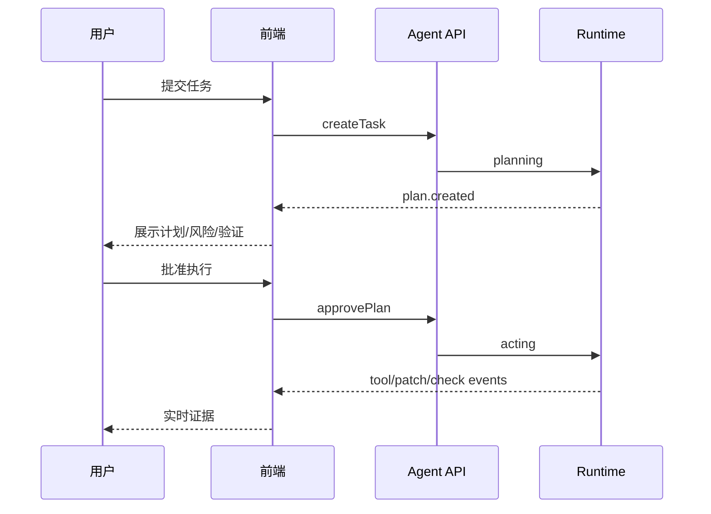

# 前端状态与流程

## 1. 状态来源

```text
服务器事实：Task / Plan / Run / Check / Finding / Patch
本地 UI：主题 / 选中 tab / 折叠面板 / 命令面板 / 本地草稿
```

服务器事实不能由组件本地 state 伪造。组件使用 view-model 将事实转成显示状态。

## 2. Task 状态

```text
draft
  → planning
  → awaiting_approval
  → acting
  → verifying
  → succeeded
```

异常分支：

```text
planning / acting / verifying → blocked
planning / acting / verifying → failed
任意未结束状态 → cancelled
```

前端显示状态与后端状态一一对应，不用“正在思考”覆盖 `blocked`、`failed` 或 `awaiting_approval`。

## 3. 事件处理

事件至少包含：

```ts
type AgentEvent = {
  seq: number
  runId: string
  type: string
  time: string
  payload: unknown
}
```

处理流程：

1. 校验事件 schema。
2. 检查 `runId` 和 `seq`，丢弃重复事件。
3. 更新事件日志和任务 view-model。
4. 只更新受影响的时间线、检查列表或状态条。
5. 在断线后使用最后游标恢复。

## 4. 计划审批流程



## 5. 断线和恢复

- WebSocket/SSE 断线时，顶部状态变为 `reconnecting`，保留最后事实。
- 重连请求携带 `lastSeq`。
- 服务器返回缺失事件；如果事件窗口已过期，前端重新拉取任务快照。
- 重连期间不允许提交重复审批或重复发送任务。
- 发送请求有 client request ID，回执不明时显示 `pending confirmation`，不自动重复执行。

## 6. 视图派生

建议集中定义：

```text
getTaskHeaderModel(task)
getPlanActionModel(plan, permissions)
getRunTimelineGroups(events)
getChecksSummary(checks)
getDeliveryState(task, checks, findings)
```

这样状态文案、按钮是否显示和主动作层级不会分散到多个组件。

## 7. 键盘流程

- `Cmd/Ctrl+K` 打开命令面板。
- `Escape` 关闭 sheet、弹窗和命令面板。
- 任务页通过 `Tab` 在标题、主动作、视图切换和证据栏之间移动。
- `Enter` 确认当前按钮或选项；危险操作必须进入第二步确认。
- 事件时间线支持跳到最新事件，但不强制打断用户正在阅读的历史事件。
