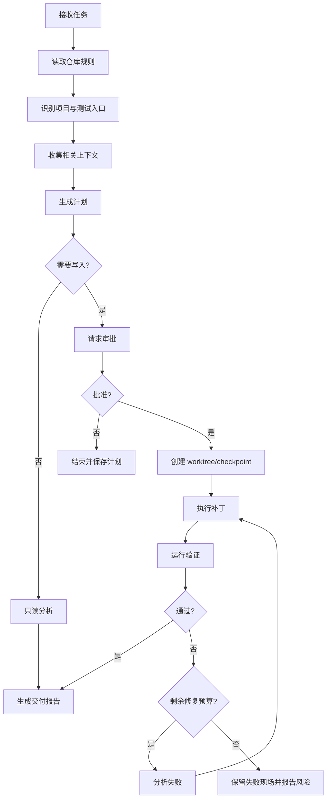
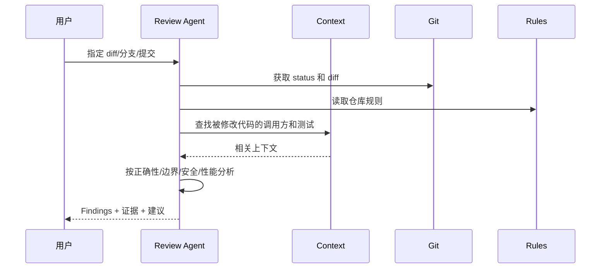
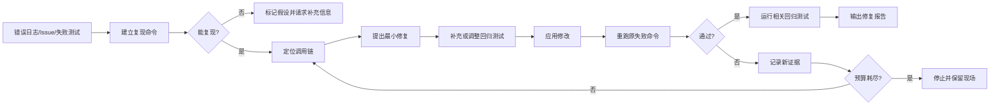

# 逻辑流程

## 1. 通用任务流程



## 2. 代码生成流程

1. 解析用户目标和验收条件。
2. 找到相关入口、类型、服务和测试。
3. 生成最小修改计划。
4. 用户审批后应用补丁。
5. 运行最相关测试，再运行必要的全量检查。
6. 如果失败，只针对失败证据修复，不盲目扩大修改范围。
7. 输出变更摘要、测试证据和剩余风险。

## 3. 代码审查流程



审查模式默认不能写文件，发现问题必须关联：

- 文件路径和行号。
- 严重级别。
- 触发条件。
- 影响。
- 可验证的修改建议。

## 4. Bug 修复流程



## 5. 自动化测试流程

1. 读取项目 manifest 和 CI 配置。
2. 推断测试、Lint、类型检查和构建命令。
3. 先运行基线命令，记录已有失败。
4. 根据变更文件选择目标测试。
5. 运行目标测试。
6. 对失败输出分类：环境、依赖、测试、实现、未知。
7. 只有实现失败且允许写入时，进入修复循环。
8. 最后输出基线和修改后的对比。

## 6. 项目脚手架流程

```text
选择模板
  → 校验名称、路径和变量
  → 复制确定性模板
  → 生成项目配置
  → 安装依赖
  → 运行基础测试/Lint/Build
  → 输出项目结构和下一步建议
```

模型用于解释需求和填充少量业务文件；目录结构、依赖版本、启动命令和基础测试由模板控制。

## 7. 审批策略

```text
读源码/搜索                  自动
生成计划                     自动
创建或修改文件               计划后审批
运行已有本地测试             可一次性授权
安装依赖/执行网络命令        单独审批
删除文件                     每次审批
commit                       可选审批
push/部署/发布               默认禁止
```
