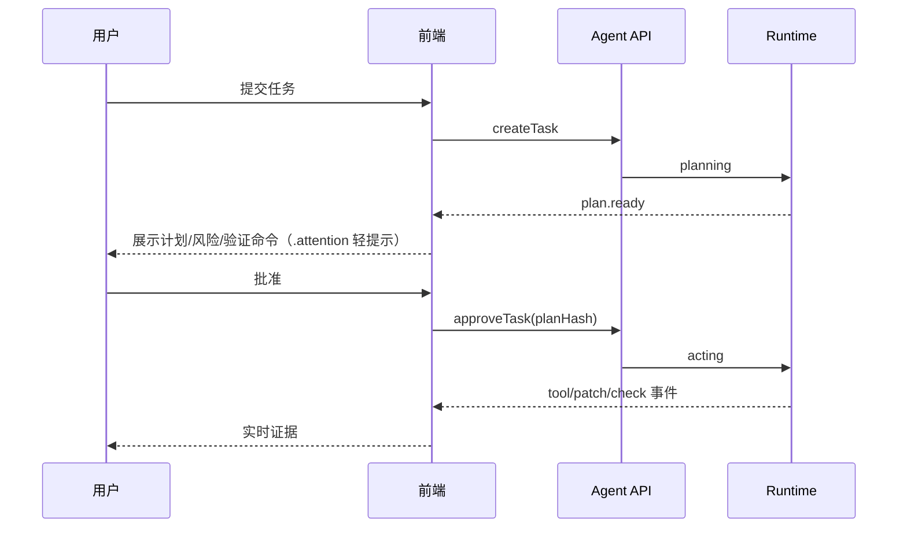

# 状态与数据流 v2

## 1. 两类状态，严格分离

```text
服务器事实（不可由组件伪造）：
  Task / Plan / PlanStep / Run / Check / Checkpoint / Finding / Patch / Health
本地 UI 状态（可由组件持有）：
  theme / navView / activeTab / activeTaskId / 命令面板 / 抽屉 / 本地草稿
  v2 新增：confirm-armed（两步确认）/ toast 队列 / disclosure 开合 / 骨架显隐
```

- 服务器事实只能通过 `runtime.ts` 接口与 SSE 订阅获得，经 `view-model.ts` 派生显示。
- 组件不得用本地 state、定时器或猜测推断任务完成、覆盖 `blocked/failed/awaiting_approval`。
- v2 的动效、Toast、骨架、armed 都是**本地 UI 状态**，不改变也不替代服务器事实。

## 2. Task 状态机

主路径：

```text
queued → planning → awaiting_approval → acting → verifying → succeeded
```

异常分支：

```text
planning / acting / verifying → blocked
planning / acting / verifying → failed
任意未结束状态 → cancelled
```

真实枚举（`shared/schemas.ts`）：

- TaskStatus：`queued, planning, awaiting_approval, acting, verifying, succeeded,
  failed, cancelled, blocked`
- PlanStepStatus：`pending, active, done`
- CheckStatus：`queued, running, passed, failed, skipped`
- FindingSeverity：`critical, high, medium, low, info`
- TaskMode：`generate, fix, review`；EventTone：`neutral, accent, ok, warn, danger, info`

## 3. 事件处理管道

```text
SSE/API
  → schema 校验（zod）
  → 按 runId + seq 去重（mergeEvents）
  → 更新事件日志
  → 受影响的时间线/检查/徽章局部刷新
  → 关键事件触发任务快照刷新
```

- 重复 `seq` 丢弃；`REFRESH_EVENTS` 内事件才触发快照刷新。
- 终态事件关闭 SSE 并转 `snapshot`；终态丢失时快照轮询兜底，终态以快照为权威。
- 新事件追加只做局部入场动效，不抢焦点、不强制滚动。

## 4. 视图派生（集中在 view-model）

`toTaskView` 与 `toUiEvent` 统一字段映射，避免状态文案与按钮显隐散落：

- `toTaskView`：格式化时间、派生 PlanStep 状态、映射 Patch、组装 diff/报告/错误/checkpoint。
- `toUiEvent`：映射 `{ title, detail, tone, kind }`，tone 规则集中可审计。
- 建议继续集中派生：头部模型、审批动作、时间线分组、检查摘要、交付状态。

## 5. 主题状态

- 主题存 `localStorage["rp-theme"]`，默认 `dark`，取值 `light | dark`。
- 应用到 `<html data-theme>`；CSS 浅色在 `:root`、深色在 `[data-theme="dark"]`。
- 切换只改 token，不重排组件结构，避免布局跳动。

## 6. 计划审批流程



- 批准携带 `plan.hash`；计划变化必须重新审批，不能用旧 hash 放行。
- 拒绝后保留计划与原因，允许改计划或结束任务。
- 高风险动作单独审批，不用一个"全部允许"掩盖差异。

## 7. 两步确认（v2 新增，破坏性动作）

```text
初始：confirm-button（默认态）
  → 第一次点击：本地置 armed=true，加 .armed，文案改为含对象与后果
  → 第二次点击：才调用 runtime 的删除/拒绝/撤销动作
  → 失焦 / Esc / 动作完成：armed=false，复位
```

规则：

- armed 是纯本地状态，不发任何请求；不自动倒计时、不自动执行。
- 动作真正执行后，结果以服务器事实为准，Toast 仅做轻反馈。
- 回执不明时显示 pending confirmation，用 client request id 防重复，不自动重试。

## 8. Toast 与骨架（v2 新增）

- **Toast 队列**是本地短暂状态：用于已保存/已复制/已发送等轻反馈；不承载关键状态、
  不替代错误解释；自动关闭或手动关闭，不改变数据。
- **骨架显隐**由加载/空数据状态派生：请求未返回且无缓存时展示骨架；数据到达即移除。
  骨架不代表数据已就绪，禁止用骨架延长掩盖失败或空态。

## 9. 断线与恢复

- SSE 断线：上下文条变 `reconnecting`，保留最后事实，不伪装失败。
- 重连携带 `lastSeq` 补齐缺失事件；窗口过期则重新拉取快照。
- 重连期间禁止重复审批/重复提交；`.is-busy` 容器阻止重复点击。

## 10. 键盘流程

- `Ctrl/Cmd + K`：命令面板；`Esc`：关闭面板/抽屉/复位 armed。
- 任务 tab：左右方向键漫游（roving tabindex）。
- `Enter`：激活按钮；破坏性操作进入并完成两步确认。
- 时间线可跳到最新，但不打断用户正在阅读的历史事件。
